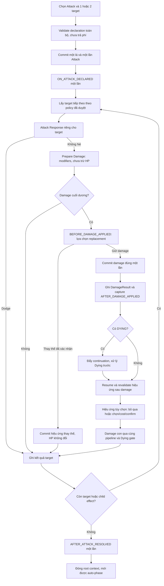

# Weapon System v1.0 — Thiết kế kiến trúc

Ngày đối chiếu workspace: **2026-11-06**. Trạng thái: **thiết kế đầy đủ đang chờ duyệt; phần trang bị cơ bản đã triển khai theo cập nhật dưới đây**.

> Cập nhật sau bản thiết kế: người dùng đã duyệt equip trong PLAY của mình, không tốn thêm bài, weapon cũ vào discard khi thay. Phần cơ bản này, range và nội tại Nỏ Thần đã được triển khai; chưa có bốn hiệu ứng chủ động hoặc CombatResolution/PendingDecision chung. EquipmentSystem dùng zone hiện có làm nguồn duy nhất thay vì thêm slot index trùng lặp; source key hiện theo owner/instance, activation ID sẽ cần khi thêm pending triggers. JSON do người dùng bổ sung dùng `equipment_slot` / `range` phẳng, không dùng schema metadata lồng minh họa bên dưới. Các phân tích gap/OPEN/milestone dưới đây là baseline thiết kế, phải đọc cùng cập nhật này và STATUS. Luật thắng người sống sót cuối và trang bị ngửa khi Hủy/Cướp cũng đã được duyệt, thay các giả định trước đó; các luật còn lại chưa tự động được chốt.

Tài liệu này thiết kế nền tảng cho năm vũ khí theo yêu cầu mới. Không thêm vũ khí vào bộ bài, không sửa gameplay code và không xác nhận rằng các API đề xuất đã tồn tại. `GDD.md` vẫn là nguồn luật đã chốt; những mục **OPEN** dưới đây phải được duyệt trước khi bật nội dung tương ứng.

## 1. Phạm vi, nguồn đối chiếu và khoảng cách kiến trúc

Đã đọc `AGENTS.md`, `GDD.md`, `ARCHITECTURE.md`, `DEVELOPMENT_PLAN.md`, toàn bộ `DEVELOPMENT_STATUS.md`; source trong `scripts/cards/`, `scripts/rules/`, `scripts/core/`, `scripts/actions/`, `scripts/combat/`, PlayablePrototype và scene F6. Đối chiếu các test Rule/Damage/Dying/Turn/UI liên quan và cách gọi suite trong `main.gd`.

Các đường dẫn source rút gọn trong bảng dưới tính từ `scripts/`. Điểm kiểm chứng chính: [GameState](../scripts/core/game_state.gd), [DamagePipeline](../scripts/combat/damage_pipeline.gd), [ActionExecutor](../scripts/actions/action_executor.gd), [RuleEngine](../scripts/rules/rule_engine.gd), [DistanceCalculator](../scripts/rules/distance_calculator.gd), [PlayablePrototype](../scripts/dev/playable_prototype.gd). Luật hiện tại đối chiếu [GDD](GDD.md), tiến độ thực thi đối chiếu [STATUS](DEVELOPMENT_STATUS.md).

Các quy tắc phải giữ: Human/dưới → Bot 1/phải → Bot 2/trên → Bot 3/trái; tự chạy phase không có quyết định; PLAY chờ kết thúc lượt hợp lệ; DYING vẫn chiếm ghế; ELIMINATED không chiếm ghế; HP âm được giữ, cứu bằng bài cho đến HP > 0. Chưa có AI, thắng/thua hay kỹ năng nhân vật hoàn chỉnh.

| Khu vực / source hiện tại | Đã có | Khoảng trống đối với vũ khí |
|---|---|---|
| `cards/card_definition.gd`, `card_instance.gd` | Definition JSON, effect dictionaries, instance ID, mô tả/suit/rank | Chưa có metadata slot/range, trigger được kiểm tra kiểu, schema cho lựa chọn/cost |
| `cards/card_database.gd`, `deck_database.gd` | Category equipment được chấp nhận; tạo instance từ JSON | Chưa xác thực slot, rule modifier hay weapon trigger; chấp nhận category không có nghĩa đã hỗ trợ equip |
| `cards/cards.gd` | `HuyenCard` cũ có enum WEAPON/ARMOR | Không phải luồng CardDefinition/CardInstance hiện dùng; không lấy enum cũ làm hệ thống vũ khí mới |
| `core/player.gd` | `equipment: Array[CardInstance]` | Không có weapon slot, giới hạn slot, API equip/replace hay đăng ký modifier theo instance |
| `core/card_zone_manager.gd` | `transfer_card`, `validate_integrity` bảo toàn lá vật lý | Chuyển từng lá; không có batch nguyên tử, thông báo lifecycle, slot guard hay callback gỡ modifier |
| `core/game_state.gd` | API draw/discard/transfer và sở hữu state | `validate_state()` còn từ chối mọi HP < 0, mâu thuẫn DYING âm đang được phép; chưa có state combat nhiều bước |
| `rules/rule_engine.gd`, `rule_modifier.gd` | `set`, `remove_limit`, owner filter; 300 > 200 > 100; remove theo source_id | Đủ cho range/Nỏ Thần, nhưng chưa tự gắn/gỡ theo trang bị. Đồng priority chọn modifier đăng ký đầu tiên; chưa có luật xung đột gameplay |
| `rules/distance_calculator.gd` | Khoảng cách vòng tròn; giữ DYING, bỏ ELIMINATED | Dùng thứ tự mảng players, trong khi TurnManager có seat_order riêng; có thể lệch khi storage không theo ghế |
| `actions/action_validator.gd` | Kiểm tra Attack đầy đủ, tool, heal, rescue | Attack chỉ một target; chưa tách validation khai báo với validation tiếp tục sau khi lá Attack đã bị tiêu hao |
| `actions/action_executor.gd` | Tiêu hao Attack và tăng attacks_used một lần; pending_attack dictionary; Dodge/pass | Dictionary chỉ chứa actor_id/target_id/card_id/damage; clear sau mỗi response; không có cursor, nguồn weapon, lựa chọn before/after damage |
| `combat/damage_pipeline.gd`, `damage_context.gd` | Damage modifiers/cancel; context source/target/original/final | `process_damage() -> bool` trả true cả khi hủy/giảm về 0. Không chứng minh HP đã giảm; không thể dùng bool đó để kích hoạt Ná/Súng trường. Chưa có replacement/pending/source kind |
| `combat/damage_modifier_registry.gd` | ID duy nhất, unregister_by_source, thứ tự priority ổn định | Không tự biết trang bị đã rời equipment; callback đồng bộ không thể chờ UI an toàn |
| `actions/effect_resolver.gd`, `combat/dying_manager.gd` | HP âm, DYING, cứu từng lá qua executor, một Dying Window | Dying nhận trực tiếp trong Attack hoặc phát hiện lại tại guard; chưa là thông báo damage thống nhất, chưa có continuation khi nhiều hiệu ứng lồng nhau |
| `combat/combat_controller.gd`, `core/turn_manager.gd` | Guard direct advance, auto-advance ≤ 32 bước, Dying ưu tiên response | Chưa chặn một pending weapon decision tổng quát; `_resume_after` hiện chỉ chạy auto-phase, chưa tiếp tục combat đang dở |
| `dev/playable_prototype.gd` | Tay bài actor, modal Dodge/tool/rescue, xác nhận/hủy, Debug | Chỉ một `_choice_kind` cục bộ; tool picker chưa là pending decision của engine; không đủ cho một effect bị Dying ngắt rồi quay lại |

**Lỗi nền tảng cần sửa trước, không sửa trong nhiệm vụ tài liệu này:** `GameState.validate_state()` kiểm tra `player.hp < 0`, nên state DYING/HP -1 hợp lệ theo luật lại bị báo lỗi. Những regression trước kiểm tra bảo toàn sau khi đã cứu về dương chưa chứng minh invariant đúng tại mọi bước trung gian. Milestone F0 phải kiểm tra ở HP -2, -1 và 0.

## 2. Kiến trúc đề xuất và ranh giới trách nhiệm

Ưu tiên mở rộng các class hiện có. Chỉ thêm **hai dịch vụ có hành vi**: `EquipmentSystem` và `CombatResolution`; những tên còn lại là dữ liệu có kiểu nhỏ, thêm theo milestone khi cần. Không tạo `NoThanController`, `DaoPhayController`…; không tạo event bus toàn cục, scripting language trong JSON hoặc framework coroutine cho từng lá.

| Thành phần | Trách nhiệm dự kiến |
|---|---|
| GameState | Sở hữu players/zones và aggregate `CombatResolutionState`; state tiếp tục không thuộc UI. Slot weapon là chỉ mục instance ID tham chiếu equipment, không là zone thứ hai |
| EquipmentSystem — mới | Query slot, chuẩn bị/commit thay đổi trang bị, ràng buộc slot, lifecycle rule/damage modifiers và trigger registrations. Dùng CardZoneManager cho mọi chuyển lá |
| CardZoneManager — mở rộng nhỏ | Primitive batch transfer được preflight toàn bộ và commit đồng bộ; báo thay đổi equipment theo batch. Không chứa luật của từng vũ khí |
| CombatController — giữ facade | Nhận command/UI, trả ActionResult và pending view; tiếp tục combat trước auto-phase. Điều phối quyền gọi, không trực tiếp chứa năm bộ luật vũ khí |
| ActionValidator — mở rộng | Validation khai báo Attack, từng target, equip/cost/decision. Tách quyền bắt đầu hành động với quyền trả lời đúng decision đang active |
| ActionExecutor — mở rộng | Commit Attack/cost/equipment effect đã hợp lệ; gọi resolution service và các primitive hiện có; không gọi UI |
| CombatResolution — mới | Máy trạng thái Attack, event checkpoints, stack continuation; chuyển descriptor effect thành primitive dùng chung; duy nhất một nơi pump/resume. Có thể giữ bảng dispatch nhỏ trong class này lúc đầu |
| DamagePipeline — mở rộng | Prepare modifiers → điểm replacement → commit HP một lần; trả DamageResult có kiểu. Chỉ xử lý damage, không mở Control/await chuột |
| EffectResolver — giữ primitive | Áp dụng HP/recovery. Tương lai thông báo ngay chuyển ALIVE → DYING qua một đầu nối duy nhất để không bỏ sót direct damage |
| DyingManager — giữ | Đăng ký/rescue/finalize người hấp hối; giữ nguyên cứu tiêu hao bài qua executor, HP âm và điều kiện hồi phục > 0. Không tự lựa chọn thứ tự multi-target |
| RuleEngine / registries — tái sử dụng | Query effective range/count; filter đúng owner và source priority; không biến trigger tùy chọn thành modifier đồng bộ chờ input |
| PlayablePrototype — mở rộng | Render equipment/pending view; gửi ID lựa chọn. Chỉ giữ draft input, không sở hữu cursor, modifier, target outcome hay quyết định đã commit |

`CombatResolutionState` gồm active AttackContext, stack frame và active PendingDecision; GameState sở hữu duy nhất, CombatResolution thao tác qua tham chiếu. Tránh ownership cycle bằng WeakRef/callback có vòng đời rõ ràng như binding TurnManager hiện tại. Dữ liệu trả UI phải là bản đọc/copy, không đưa mảng mutable nội bộ.

### 2.1 API dự kiến và tương thích

Các chữ ký sau là **đề xuất**, không phải API đã có:

```gdscript
func use_attack_targets(actor_id: int, target_ids: Array[int], card_id: int) -> ActionResult
func equip_weapon(actor_id: int, card_id: int) -> ActionResult
func submit_decision(actor_id: int, decision_id: int, revision: int, selection: Dictionary) -> ActionResult
func decline_optional_effect(actor_id: int, decision_id: int, revision: int) -> ActionResult
func get_pending_decision() -> PendingDecision
```

Giữ `use_attack(actor_id, target_id, card_id)` làm adapter một target; `respond_to_attack(target_id, dodge_card_id=0)` trả lời response active, không được trả lời target chưa tới lượt. Giữ `ActionResult.valid/reason` làm kết quả command, **không dùng valid để suy ra damage_applied**.

Giữ `pending_attack` như compatibility view của response hiện tại trong giai đoạn chuyển đổi. AttackContext là nguồn authoritative; view được dựng từ context, không có hai state writable độc lập. `has_pending_attack()` / guard mới vẫn giữ chặn suốt Attack chưa hoàn tất, kể cả lúc không có response nhưng đang chọn hiệu ứng. Không clear cả AttackContext sau response đầu tiên.

Giữ `DamagePipeline.process_damage(source_id, target_id, amount) -> bool` như adapter đồng bộ cho caller cũ; thêm prepare/commit/result API. Adapter vẫn trả true cho handled/cancelled/zero như hiện nay, không được âm thầm đổi nghĩa. Caller vũ khí chỉ dùng DamageResult. Direct/legacy damage không tự giả danh Attack để kích hoạt vũ khí.

Mọi đoạn GDScript sau này dùng TAB và explicit typing; JSON vào Dictionary được validate rồi chuyển sang dữ liệu có kiểu ở biên. Không sửa 13 suite thành những test bỏ qua kết quả cũ; thêm fixture mới và giữ smoke F6.

## 3. AttackContext, nguồn sát thương và kết quả

### 3.1 Dữ liệu Attack

| Trường đề xuất | Ý nghĩa |
|---|---|
| attack_id: int, revision: int | Nhận diện lần sử dụng, chống command cũ/nhấp đôi |
| actor_id: int, attack_card_id: int | Người dùng và instance Attack đã tiêu hao; không đòi lá vẫn ở hand khi resolve |
| target_ids: Array[int], primary_target_id: int | Danh sách duy nhất đã khai báo và target chính; thêm resolution_order riêng sau khi có luật thứ tự |
| resolution_order: Array[int], target_cursor: int | Trật tự được policy đã duyệt tạo ra; không suy từ click/node/Dictionary iteration |
| weapon_instance_id: int, weapon_definition_id: String, equipment_activation_id: int | Vũ khí tại thời điểm khai báo, kể cả trường hợp nó mất sau đó |
| weapon_snapshot: Dictionary | Copy dữ liệu provenance/effect descriptors; **không tự trao hiệu lực sau khi vũ khí đã mất** |
| base_damage: int, effective_range_at_declaration: int | Damage JSON và bằng chứng validation; không mặc định quyết định freeze/recheck range sau đó |
| card_paid: bool, use_counted: bool | Commit duy nhất; continuation không trả phí hoặc tăng attacks_used lần nữa |
| stage, target_results, pending_after_effects | Stage rõ ràng và kết quả từng target, sống xuyên qua response/Dying |

`AttackTargetResult` giữ target_id, response (chưa tới lượt/đang chờ/Dodge/pass), DamageResult và resolved/skipped reason. Không gộp Dodged với damage cancelled/replaced: các trigger khác nhau cần biết nguyên nhân.

### 3.2 DamageContext / DamageResult

Mở rộng DamageContext hiện có bằng damage_id, root_attack_id, parent_effect_id, weapon source instance/activation, `source_kind` và `is_primary_attack_damage`. Tách **actor gây damage** với **origin dùng để đo khoảng cách**: Ná vẫn gây damage từ chủ vũ khí, nhưng đo từ mục tiêu chính.

Các source_kind tối thiểu: `ATTACK_CARD`, `WEAPON_EFFECT`, `OTHER_EFFECT`, `LEGACY_DIRECT`. Không suy loại nguồn từ actor_id, tên card hoặc việc đang có pending_attack. Ná tạo WEAPON_EFFECT với root_attack_id trỏ đòn gốc; không mở Attack Response nếu chưa có luật xác nhận.

DamageResult nên có status (`APPLIED`, `CANCELLED`, `ZERO`, `REPLACED`, `INVALID`, hoặc pending handle trước commit), hp_before/hp_after, actual_hp_loss, source/target IDs, caused_dying, replacement_effect_id. Với HP âm, damage từ 1 xuống -1 là actual_hp_loss = 2, không cắt ở 1.

Điều kiện kích hoạt “gây sát thương thành công” của Ná/Súng trường: **status APPLIED và actual_hp_loss > 0**, đúng source kind/root/target mà descriptor yêu cầu. Dodge, cancel, giảm về 0 hoặc Dao replacement không thỏa điều kiện; bool success của command/pipeline không đủ.

### 3.3 Một đầu nối lethal notification trước khi thêm damage phụ

F0 cần đặt thông báo chuyển ALIVE → DYING ngay tại điểm commit HP dùng chung của EffectResolver, nối đồng bộ tới DyingManager trước khi nhận gameplay command. Pipeline Attack, child damage và direct resolver đều đi qua điểm này; adapter direct không được tự gán một attacker/weapon giả khi chữ ký cũ không có nguồn. Có thể bổ sung metadata tùy chọn, giữ lời gọi cũ là nguồn legacy không có quyền proc Attack.

Thông báo chỉ đăng ký trạng thái/cửa sổ, không lập tức mở UI hay đệ quy resume combat. Khi chuyển về coordinator, Dying đã được ghi nhận trước mọi continuation. Khóa damage/transition ID chống đăng ký hai lần; migrate block begin_dying trong respond_to_attack hiện tại sang endpoint chung sau khi có test chứng minh, không để cả hai cùng đăng ký rồi báo failure sau một damage đã thành công.

Giữ boundary scan hiện có làm kiểm tra an toàn, không dùng nó làm cơ chế chính khi thêm child damage. Nếu có một nguồn lỗi/nested chưa có contract tạo thêm DYING trong lúc cửa sổ khác đang mở, giữ state và dừng diagnostic; không ghi đè dying_player_id hoặc chọn một thứ tự xử lý bằng storage order. Phiên bản đầu serialize damage/frame để tránh áp dụng damage kế tiếp khi còn Dying; thứ tự nhiều lethal độc lập là OPEN của Stage 0.3.

## 4. Luồng Attack và các checkpoint

Sơ đồ dưới mô tả cấu trúc điều khiển; vị trí tương đối của một số trigger/modifier còn cần duyệt ở mục 12. Không thể suy thứ tự gameplay từ thứ tự nối signal.



Nhánh không có child effect đi thẳng tới hoàn tất target; sơ đồ không bắt buộc mọi hiệu ứng phải gây damage con. Ở bất cứ điểm nào có DYING, kể cả do một nguồn ngắt từ ngoài, tạm dừng frame hiện tại và không xử lý response/optional effect khác.

### 4.1 Contract event có kiểm soát

| Checkpoint | Cardinality / payload | Cách dùng |
|---|---|---|
| ON_ATTACK_DECLARED | Một lần sau commit; toàn bộ target và weapon provenance | Quan sát/log/capture. Khả năng thêm target phải được dùng trong planning **trước commit**, không thêm target chưa validate sau khi trả phí |
| BEFORE_DAMAGE_APPLIED | Mỗi damage candidate còn có thể áp dụng; trước HP commit | Điểm mở replacement, không gọi effect rồi hoàn tác HP |
| AFTER_DAMAGE_APPLIED | Mỗi DamageResult APPLIED dương, ghi nhận một lần ngay sau HP commit | Capture điều kiện/provenance, nhưng treo việc đưa lựa chọn cho người chơi nếu đang Dying |
| AFTER_ATTACK_RESOLVED | Một lần khi mọi target và descendant đã terminal, kể cả Dying/after-effects | Báo kết thúc root, cleanup; không phát sớm khi mục tiêu đầu vừa Dodge |

Event là bản ghi có event_id, root_id, parent_id, source_activation_id và snapshot kết quả. Dispatcher chỉ tìm descriptor phù hợp rồi tạo frame/decision; listener không tự gọi dây chuyền ActionExecutor hoặc mutate HP ngay trong signal callback. Signal Godot có thể dùng thông báo UI, không quyết định thứ tự luật.

Damage modifiers đang có chạy đồng bộ; optional replacement là checkpoint ngoài vòng callback đó. **Đề xuất** prepare toàn bộ modifiers trước BEFORE_DAMAGE_APPLIED để Dao chỉ chọn khi damage thực sự còn dương; cần duyệt quan hệ với giáp/trigger tương lai, không áp đặt bằng priority số của RuleEngine.

Dying xảy ra sau HP commit nhưng trước lựa chọn sau damage. Capture event giữ bằng chứng target đã nhận damage, không bảo đảm hiệu ứng vẫn hợp lệ sau cứu/loại; hiệu lực sau đó là policy cần chốt, không đánh đồng “event đã xảy ra” với “effect được phép tiếp tục”.

## 5. Equipment Slots và vòng đời modifier

### 5.1 Một nguồn sở hữu lá vật lý

Giữ `Player.equipment` là zone vật lý để các API/tests hiện có tiếp tục dùng. Weapon slot dự kiến chứa **tối đa một instance ID**, là chỉ mục tới một lá trong zone đó; các slot armor/khác chưa triển khai. Không sao chép CardInstance vào kho slot mới hoặc đếm thêm zone trong conservation.

Tách rõ:

- `slot_id` trả lời loại vị trí; `instance_id` là lá thật; `activation_id` là một lần lá đó được trang bị. Cùng lá tháo rồi trang bị lại có activation mới để loại trigger/decision cũ.
- Chỉ có weapon slot là phạm vi v1.0. Quy định lúc nào được equip, có được tự unequip, thay vũ khí cũ đi đâu và xử lý equipment khi bị loại vẫn **OPEN**.
- Query `get_weapon(player_id)` không sửa zone. State load/fixture phải rebuild/validate chỉ mục và registry, không lặng lẽ chọn một trong hai weapon nếu dữ liệu sai.

### 5.2 Commit equip / replace / unequip / destroy

1. ActionValidator kiểm tra actor, cửa sổ/phase hợp lệ theo luật đã duyệt, ownership, category/slot, destination và operation intent. Slot đang bận phải đi qua replace hợp lệ; không append tùy ý.
2. EquipmentSystem lập batch transfer gồm weapon cũ/new, các modifier/trigger cần detach/attach. Preflight toàn bộ ID, source/destination và tính duy nhất trước mutation.
3. Commit đồng bộ, không emit callback gây gameplay ở giữa: chuyển lá qua CardZoneManager, cập nhật slot index, gỡ source cũ, gắn source mới. Chỉ publish batch-committed sau khi cả zone/slot/registry nhất quán.
4. Nếu preflight thất bại: không mất bài/registry. Nếu gặp lỗi commit nội bộ bất ngờ: khôi phục toàn bộ zone/index/registration trước khi trả failure; không emit trigger từ state tạm. Không dùng rollback HP để thay damage.

Mọi đường rời equipment đều phải đi qua cùng lifecycle: unequip, replace, Hủy, Cướp, Súng trường, chuyển chủ hoặc cleanup được luật yêu cầu. Không chỉ gỡ modifier trong nút Unequip. Cần hook tại primitive transfer/batch của CardZoneManager hoặc một cổng commit bắt buộc mà **tất cả caller hiện có đã được migrate**; nếu chỉ thêm EquipmentSystem mà để `use_tool()` transfer trực tiếp như hiện tại thì vẫn lọt modifier ma.

Khi Cướp đưa weapon vào hand của người khác: nó mất hiệu lực ở chủ cũ ngay khi commit, **không tự equip cho chủ mới**. Destroy/discard chuyển vào discard, không xóa instance khỏi original deck IDs. Đích đến khi tự tháo/replace là luật cần duyệt riêng, không lấy chữ “destroy” để xóa object.

### 5.3 Modifier theo instance, không theo tên vũ khí

Source key gợi ý: `equipment:<owner_id>:<instance_id>:<activation_id>`. Cùng key quản lý RuleModifier, DamageModifier và trigger registrations. Dùng `RuleEngine.remove_modifier(source_id)` và `DamageModifierRegistry.unregister_by_source(source_id)` đang có; detach idempotent, attach một lần.

- Weapon range 1/2/3/4/5: `RuleModifier("attack_range", "set", range, CARD_EFFECT, source_key, owner_id)`.
- Nỏ Thần: thêm `attack_limit_per_turn / remove_limit / CARD_EFFECT / owner_id`; không reset attacks_used, không sửa rule range/phase/ownership.
- Tháo Nỏ sau khi đã Attack nhiều lần: bỏ unlimited ngay; với counter đang cao hơn giới hạn base thì Attack tiếp theo bị chặn đúng như RuleEngine hiện có. Không giảm counter để tặng lượt.
- Giữ ưu tiên `CHARACTER_SKILL=300 > CARD_EFFECT=200 > BASE_RULE=100`; không dùng 201/999 để vũ khí thắng kỹ năng.
- Tầm in trên lá là range của weapon; **tầm hiệu lực UI phải query RuleEngine với actor context**, vì kỹ năng có thể ghi đè. Tháo weapon trở về rule còn lại, không hardcode range=1 đè lên kỹ năng.
- Đồng priority hiện giữ modifier đầu tiên. Cần quyết định gameplay khi equipment/global card effects cùng sửa một rule; chưa thay bằng “mới nhất thắng” hoặc stack cộng dồn.

RuleEngine hiện chọn **một** modifier thắng cho mỗi rule; DamageModifierRegistry lại chạy các modifier áp dụng được theo priority cao trước. Không dùng một thuật toán stack chung để vô tình thay đổi hai contract này; trigger-order policy là một vấn đề khác với source priority của rule.

Snapshot trong AttackContext chỉ dùng truy vết. Passive modifier mất ngay khi rời slot. Việc active Attack đã khai báo còn dùng trigger/range snapshot hay không là quyết định gameplay riêng ở mục 12; kiến trúc lưu cả snapshot và live activation để hỗ trợ policy đã duyệt mà không giữ passive ma.

## 6. Cấu trúc dữ liệu vũ khí đề xuất

Schema minh họa tương lai, **không được chép vào cards.json/standard.json ở nhiệm vụ này**. Mở rộng CardDefinition bằng metadata equipment tùy chọn; definition cũ không có field vẫn load được. Không thêm DSL, script path hoặc Callable tùy ý từ JSON.

Ví dụ Nỏ Thần dùng operation đang được RuleEngine hỗ trợ:

```json
{
  "id": "weapon_no_than",
  "name": "Nỏ Thần",
  "category": "equipment",
  "subcategory": "weapon",
  "description": "Tầm 1. Trong giai đoạn sử dụng bài, không giới hạn số lần dùng Tấn công.",
  "equipment": { "slot": "weapon", "attack_range": 1 },
  "effects": [
    {
      "effect_id": "modify_rule_while_equipped",
      "parameters": {
        "rule_id": "attack_limit_per_turn",
        "operation": "remove_limit"
      }
    }
  ]
}
```

EquipmentSystem dịch attack_range thành CARD_EFFECT modifier, không đăng ký range thêm lần thứ hai trong effects. Priority/owner/source_key do engine gán theo nguồn thật; JSON không được tự khai quyền CHARACTER_SKILL.

Các descriptor còn lại dự kiến dùng chung cấu trúc `effect_id`, `trigger`, `optional`, `parameters`. Runtime handler chỉ chấp nhận whitelist ID và field hợp lệ:

| Vũ khí | Tầm | Descriptor / tham số chính | Policy chưa có |
|---|---:|---|---|
| Nỏ Thần | 1 | modify_rule_while_equipped, remove_limit | Tie cùng nguồn/card priority nếu có |
| Dao Phây | 2 | replace_damage_with_discard; BEFORE_DAMAGE_APPLIED; optional; target_zone=hand; count=2 | Người chọn, visibility, thiếu hai lá, quan hệ với modifiers |
| Ná Cao Su | 3 | discard_cost_then_damage; AFTER_DAMAGE_APPLIED; optional; own hand cost=1; secondary damage=1; distance_origin=primary_target; max_distance=1; source_kind=WEAPON_EFFECT | Cho chọn chính chủ vũ khí làm secondary hay không; DYING/elimination/lifetime, trigger scope |
| Súng lục | 4 | additional_attack_target; planning capability; max_extra_targets=1 | Thứ tự, vai trò target chính, revalidation giữa các target |
| Súng trường | 5 | discard_target_equipment; AFTER_DAMAGE_APPLIED; optional; count=1 | Người chọn, visibility và quyền tác động target sau Dying/elimination |

Không cần rule mới cho max targets ở bước đầu: capability 1+1 thuộc descriptor của Súng lục, được validator đọc trước commit. Nếu sau này kỹ năng cũng sửa target cap, phải thiết kế rule tương ứng và base key trước; `RuleEngine.get_rule()` hiện trả `{}` cho rule không có trong base_rules.

Policy còn thiếu được lưu bằng key tham chiếu policy đã được duyệt hoặc `null` trong tài liệu/schema draft; không có default ngầm như `discard_up_to_2`, `attacker_selects`, `click_order`. Loader tương lai báo lỗi hoặc đánh dấu nội dung chưa thể bật nếu policy bắt buộc chưa có. Test có thể inject policy giả lập rõ ràng, không biến fixture thành luật chính thức.

Validator schema phải kiểm tra số nguyên dương/finite, slot hợp lệ, trigger/effect whitelist, cost zone/count, rule operation được hỗ trợ và policy dependencies. CardDatabase hiện chỉ kiểm tra shape effects chung; cần milestone schema riêng. Suit/rank/copies vẫn ở deck JSON hiện tại; không cân bằng hay thêm bản sao vũ khí trong thiết kế này.

## 7. Pending decisions, optional effects và continuation

### 7.1 State thuộc engine

PendingDecision dự kiến chứa decision_id/revision, kind, chooser_id, root_attack_id/frame_id, source activation, allowed choices, selection constraints, cost specification, visibility, can_decline và resume point. Choice draft không chuyển bài. ID lựa chọn bài úp gửi UI là opaque option token; mapping sang instance ID nằm trong engine, tránh lộ hidden card data qua tooltip/payload. Debug nhìn tay Bot vẫn là chế độ ghi rõ, không cấp quyền quyết định thay owner.

Các kind tối thiểu: attack_response, activate_or_decline, select_cost_and_target, select_affected_cards, dying_rescue. Có thể gộp activation + cost + target trong một màn hình để không cần nhiều modal nhỏ; engine vẫn giữ một decision active.

Command confirm phải kiểm tra:

1. ID/revision đúng decision active/top frame, actor đúng chooser, chưa consumed, không có Dying ưu tiên hơn.
2. Effect còn hợp lệ theo source activation và policy đã duyệt; target còn tồn tại, đúng life state/zone, range tính đúng origin, không trùng ID.
3. Cost cards vẫn thuộc đúng owner/hand và đủ số; affected cards đúng target/zone/count; không thanh toán bằng lá Attack đã dùng.
4. Preflight cả cost và effect; commit một lần, đánh dấu decision consumed và di chuyển cursor trước khi publish event/resume.

Command cũ hoặc selection lỗi không mất tài nguyên, không tự chuyển sang normal damage/bỏ qua hiệu ứng. Refresh candidate list và giữ quyền chọn lại/bỏ qua nếu action optional. `decline` chỉ đóng optional frame; **không hủy lá Attack đã commit**, không hoàn lại cost của một child effect đã hoàn tất trước đó. Hủy draft trước commit không trả phí; không dùng chung nút “Hủy” với “Không Né” hay “Không cứu”.

### 7.2 Stack và ưu tiên

ResolutionFrame dữ liệu gồm frame_id/parent/root, stage, cursor, payload và completed flag. Dùng stack tường minh, không chờ UI bằng recursion/await kéo dài trong DamageModifier callback. Frame sau damage giữ các after-effects còn lại; frame multi-target giữ cursor ngoài; Dying ngắt frame hiện tại rồi tiếp tục đúng chỗ.

Thứ tự điều khiển: **Dying → decision của frame active (response hoặc effect đúng checkpoint) → continuation còn lại → normal actions/auto-phase**. Không mở response mục tiêu B trong khi mục tiêu A còn optional effect. Nếu một Dying khác xuất hiện, giữ pending decision cũ suspended; sau cứu/loại revalidate, không dựng lại hiệu ứng từ đầu và thanh toán lại.

TurnManager guard và ActionValidator đọc chung `is_combat_busy()/get_block_reason()` qua binding hiện có; không chỉ UI disable button. Guard phải phủ cả direct advance/start/end_play, use_attack/tool/heal/discard/equip và Debug draw. Riêng trả lời đúng decision/rescue được phép qua API chuyên biệt; không gọi validator “bắt đầu Attack” cho continuation, vì chính pending Attack sẽ chặn nó.

`set_phase_wait()` giữ cho judgment/effect phase chưa hỗ trợ; không dùng một chuỗi phase hold làm toàn bộ stack vũ khí. `_resume_after()` tương lai pump combat trước, chỉ gọi auto-phase khi root/frame/decision/Dying đều rỗng. Không reset counter hoặc phát turn_started trong quá trình resume một Attack.

### 7.3 Giới hạn kỹ thuật và chống lặp

Đề xuất kỹ thuật để duyệt khi triển khai: tối đa 8 frame lồng và 64 bước nội bộ cho một pump; giữ giới hạn 32 phase của controller. Có in_pump guard chống reentry. Mỗi activation dùng khóa `(event_id, equipment_activation_id, effect_id)` để không phát lại sau Dying/resume; mỗi damage_id có cờ applied_once.

Chạm giới hạn phải dừng với diagnostic + context giữ nguyên, không tự chấp nhận/decline, không tăng giới hạn theo input tùy tiện và không coi đã resolve. Đây là chống lỗi/vòng lặp, không là luật chặn người chơi dùng nhiều Attack hợp lệ của Nỏ Thần. Các lần Attack người chơi xác nhận riêng không cộng thành một pump vô hạn.

## 8. Damage replacement và thanh toán nguyên tử

Dao Phây dùng một nhánh **NORMAL_DAMAGE XOR DISCARD_REPLACEMENT**. Tại replacement checkpoint, target chưa mất HP. Chưa có lựa chọn thì giữ candidate damage trong frame; không gọi resolver rồi cộng lại HP.

Nếu chọn replacement: validate policy/đúng hai card IDs và toàn bộ transfer; commit batch target hand → discard; đánh dấu DamageResult REPLACED/actual_hp_loss=0. Không gọi commit_damage, không phát AFTER_DAMAGE_APPLIED, không mở Dying do damage đã bị thay. Nếu chọn A, đi commit_damage bình thường. Nếu selection stale, không được bỏ một lá rồi gây damage hoặc fallback sang A mà chưa được đồng ý.

Ná thanh toán cost và chấp nhận child damage trong một command đã preflight: discard đúng một own-hand card, tạo child DamageContext và continuation. Modifier hủy child damage sau khi cost đã trả là **một effect đã được thực hiện nhưng damage bị hủy**, không tự hoàn phí. Đây là đề xuất commit boundary cần duyệt; lỗi kỹ thuật trước khi chấp nhận effect phải không tiêu hao bài. Không re-run modifier/cost khi resume; mọi lựa chọn có thể phát sinh trong child được biểu diễn bằng frame riêng.

Súng trường discard equipment cũng là batch có lifecycle. CardZoneManager chuyển xong thì detach modifier/trigger phải hoàn tất trước event/hành động kế tiếp. Không copy logic gỡ modifier vào riêng handler Súng trường.

Prepare Damage không được làm thay đổi HP/card/counter. Nếu Dying ngắt decision khiến dependency như armor/source equipment thay đổi trước commit, phải revalidate prepared candidate. Việc recompute final damage hay giữ snapshot modifier là policy cần chốt; lưu dependency/source activation để phát hiện thay đổi, không âm thầm dùng candidate cũ hoặc chạy modifier có side effect lần nữa.

## 9. Ánh xạ năm vũ khí và các tình huống DYING

### 9.1 Nỏ Thần — tầm 1

Chỉ hai passive modifier: range=1 và remove_limit attack count. Giữ counter thật để tháo vũ khí có hiệu lực ngay. Owner, PLAY, target khác mình, ALIVE, range, ownership, pending windows vẫn kiểm tra bình thường. Range 1 không được bỏ qua chỉ vì unlimited=true của **rule count**.

### 9.2 Dao Phây — tầm 2

Sau response không Dodge, prepare damage dương mới mở lựa chọn A/B theo checkpoint đề xuất. A là damage hiện có; B là effect replacement dùng chung. **Không đủ hai lá:** chưa chốt “không được chọn B”, “bỏ tất cả”, hay “bỏ được bao nhiêu”; không implement một cách nào. **Người chọn hai lá và thông tin được xem:** chưa chốt attacker, victim hay chọn úp. Trước khi có các policy này, không bật nhánh B trong bản chơi; dev phải hiện trạng thái thiếu luật, không ngẫu nhiên bỏ bài.

### 9.3 Ná Cao Su — tầm 3

Trigger chỉ từ damage chính thực nhận của Attack, không từ Dodge/zero/cancel/replacement. Chọn kích hoạt/bỏ qua, một own-hand cost và một secondary target khác primary. Range predicate: `distance(primary_target_id, secondary_id) <= 1`, với thứ tự ghế authoritative và chỉ bỏ ELIMINATED; **không dùng effective weapon range=3 cho damage phụ**.

Đã chắc chắn theo luật hiện có: nếu có người đang DYING thì chưa cho thanh toán/kích hoạt damage phụ; cần cứu/loại trước. Trong khi primary đang DYING, snapshot event vẫn lưu nhưng optional frame suspended. Nếu secondary dự kiến DYING, revalidation chưa cho commit; không tăng damage âm cho người đang hấp hối qua API damage hiện vốn chỉ nhận ALIVE.

**OPEN sau khi xử lý Dying:** primary được cứu thì có cho kích hoạt tiếp không; primary bị loại thì hủy optional effect hay đo từ snapshot ghế cũ; secondary bị loại thì được chọn lại hay effect hết hạn; chủ vũ khí đang DYING/đã loại thì xử lý pending activation ra sao. Không đo từ ELIMINATED bằng cách coi distance=-1 là hợp lệ. Nếu duyệt snapshot khoảng cách, phải lưu đầy đủ vòng ghế tại mốc được duyệt, không chỉ ID đã mất ghế.

Secondary damage dùng source_kind=WEAPON_EFFECT, amount=1, qua cùng DamagePipeline và DyingManager; không tiêu hao thêm Attack, không tăng count, không tự mở Dodge. Không tự kích hoạt lại Ná/Súng trường vì source kind không phải damage chính từ Attack. Các chain trigger khác nếu sau này có phải được duyệt riêng.

### 9.4 Súng lục — tầm 4

Planning cho phép 1 hoặc 2 target duy nhất; từng target validate range=effective_range và điều kiện riêng trước commit. Bất kỳ target không hợp lệ đều làm declaration thất bại trước mất Attack, không âm thầm cắt danh sách. Commit một lá, một counter, một ON_ATTACK_DECLARED; sau đó xử lý từng response độc lập.

Cursor và target outcomes sống xuyên Dying: ví dụ target A nhận lethal → treo root ở sau damage A → cứu/loại A → xử lý after-effects A theo policy → mới response B. Không tạo Attack mới cho B hoặc revalidate ownership của lá đã nằm discard. ELIMINATED target chưa tới lượt không thể bị yêu cầu Dodge; cần terminal result ghi rõ như behavior stale-target hiện tại.

**OPEN bắt buộc:** thứ tự target do attacker chọn, theo ghế ngược kim đồng hồ hay primary trước; thời điểm chốt primary; range/target legality có xét lại sau target A đổi ghế/equipment hay không; attacker bị loại giữa chuỗi có tiếp tục B không. Chưa có luật thì không mặc định sort theo seat_order hoặc array click order. Khuôn máy trạng thái nhận resolution_order đã được duyệt, không tự phát sinh thứ tự.

### 9.5 Súng trường — tầm 5

AFTER_DAMAGE_APPLIED dương tạo optional frame nếu target có equipment hợp lệ. Candidate list lấy từ zone hiện tại và slot registry, không từ hand/judgment. Người có quyền theo policy chọn đúng một equipment; confirm revalidate, batch discard và detach. Nếu hết equipment trước khi mở frame: không có candidate, effect không thể kích hoạt; nếu hết sau khi chọn: reject selection không mất tài nguyên, không chọn thay.

Đặc tả chưa xác định dứt khoát ai chọn trang bị bị bỏ: đề xuất owner của trigger điều khiển, **cần duyệt**, không coi đề xuất là luật. Quyền tác động lên target DYING/đã bị loại, thời điểm cleanup equipment và việc giữ trigger sau khi mất Súng trường cũng cần chốt. Khi đang DYING, modal hấp hối phải được giải quyết trước, không tháo armor/weapon để thay đổi sự kiện damage đã commit.

## 10. UI integration

- Mỗi ghế thêm weapon slot nhỏ: tên, printed range và effective range nếu khác; tooltip đọc JSON. Slot rỗng hiển thị rõ; click equip/replace gửi command, không sửa equipment array.
- Attack planning cho chọn target chính + target bổ sung (nếu capability được duyệt); highlight target hợp lệ riêng, xác nhận toàn bộ. Thứ tự resolve chỉ hiện sau khi có policy; không lấy vị trí node làm luật.
- Optional modal có kích hoạt/bỏ qua, cost-card picker, target/equipment picker tùy constraints. Dao trình bày A/B, không trừ HP để preview; Ná trình bày rõ range tính từ primary; Súng trường chọn equipment thật.
- Dying modal hiện HP âm, chọn người cứu và lá Hồi máu như hiện tại. Tạm thay view active khi Dying ngắt, giữ suspended engine decision; khi quay lại render lại theo ID/revision mới và candidate hiện có.
- Phân biệt Hủy draft, Bỏ qua tùy chọn, Không Né và Không cứu. Hủy draft không phải pass có hậu quả gameplay.
- Debug tiếp tục điều khiển Bot thủ công nhưng phải qua cùng validation; rút bài Debug không được thay đổi tài nguyên khi có weapon decision. Không đổi default main scene, giữ F6 và bàn 16:9.
- UI đọc view từ controller thay việc dựa hoàn toàn vào pending_attack dictionary; trong migration vẫn giữ node IDs cần cho smoke hoặc cập nhật test có lý do rõ ràng. Event log dùng event/result IDs để không ghi cùng hiệu ứng hai lần do refresh.

## 11. Ma trận kiểm thử và kế hoạch milestone

### 11.1 Trường hợp cần kiểm thử

| Nhóm | Ca bắt buộc |
|---|---|
| Invariants nền | Validate state ở ALIVE dương, DYING -2/-1/0, hồi lên 1; reject ALIVE âm, DYING dương, HP > max; conservation sau mỗi cost/partial rescue |
| Ghế/khoảng cách | Storage khác seat_order với hoán vị bất kỳ, không chỉ đảo ngược; ghế DYING giữ vị trí, ELIMINATED bỏ; origin Ná là primary. Bàn 4 người chỉ có khoảng cách tối đa 2: cần fixture 6–12 ghế để thử boundary range 3/4/5 và ngoài range, không đổi số người của prototype |
| Equipment lifecycle | Equip rỗng/replace/tháo/Hủy/Cướp/Súng trường; transfer sai source; attach/detach một lần; hai instance cùng definition, lá tháo rồi equip lại; không gỡ modifier người khác; registry không có source ma |
| Rule precedence | Skill 300 thắng weapon 200; owner isolation; tháo về rule còn lại; tie cùng priority theo luật được duyệt; Nỏ bỏ count nhưng không bypass range/phase/target/windows |
| Attack commit | Một/two targets đúng một lá và counter; duplicate/self/out-of-range/không sở hữu/target không tồn tại fail trước payment; invalid list không bị cắt ngầm |
| Damage result | Dodge/cancel/zero/invalid/replaced không phát trigger damage thành công; positive/overkill báo actual_hp_loss đúng; event applied/resolved đúng một lần |
| Dao | A damage đúng một lần; B đúng số bài không mất HP; missing policies; target thiếu 0/1 lá; selection stale/duplicate; nhấp đôi; không vừa bỏ bài vừa damage |
| Ná | Tùy chọn bỏ qua không cost; cost không-owned/đã dùng/sai zone; chọn primary làm secondary bị chặn; đúng origin range; thiếu cost; child cancel sau payment; child lethal/negative HP mở Dying; không tự Dodge và không tự lặp trigger |
| Súng lục | 1/2 responses độc lập; A Dodge/B damage và ngược lại; A lethal suspend rồi B; loại target B trước tới lượt; attacker/weapon mất giữa chuỗi; không clear cursor hoặc tăng counter khi resume |
| Súng trường | Không proc nếu không có actual damage; không có equipment; chọn đúng equipment; candidate mất trước confirm; gỡ range/count/armor modifiers ngay; target DYING/eliminated theo policy |
| Decision/stack | Wrong chooser/ID/revision, duplicate submit, stale activation, reentry; Dying preempt trước/giữa/after effect; hủy draft/decline không mất tài nguyên; không double payment; budget/depth stop không auto-pass |
| UI/API guards | Direct TurnManager advance/start/end_play, executor calls và Debug draw đều bị chặn khi pending; rescue vẫn dùng bài; Human/Bot cùng API; mô tả JSON, hidden picker không lộ thông tin, F6 smoke |

Mỗi policy OPEN cần test table sau khi duyệt; không viết assertion lựa chọn luật thay người thiết kế. Dùng fixture in-memory/test JSON tạm cho vũ khí, giữ standard deck hiện tại. Không thêm vũ khí thật chỉ để test loader hoặc làm suite cũ pass.

### 11.2 Milestone nhỏ, có điểm dừng

| Mốc | Nội dung | Điều kiện qua |
|---|---|---|
| D0 — nhiệm vụ hiện tại | Thiết kế và danh sách OPEN, cập nhật PLAN/STATUS | Chỉ tài liệu; không code/data changes; chờ duyệt |
| F0 — trước Weapon | Sửa invariant HP âm theo luật đã chốt; thống nhất seat order dùng cho distance; thống nhất lethal notification ở Stage 0.3 | Test state âm tại bước trung gian, direct/child damage mở Dying đúng một lần; không đổi rescue rule |
| F1 — trước Weapon | AttackContext một target, DamageResult/source kind; giữ adapters cũ | 13 suites + smoke giữ hành vi cũ; phân biệt applied/cancel/zero; một card/counter |
| F2 — trước Weapon | PendingDecision/stack có giới hạn, controlled checkpoints; migrate response/Dying; engine guard mọi đường | Pause/resume không double payment/trigger, direct bypass và budget tests; chưa cần weapon content |
| W1 | Equipment slot/lifecycle/batch và schema test; range modifiers | Detach ngay trên tất cả đường transfer; chưa sửa standard deck |
| W2 | Passive Nỏ Thần qua descriptor in-memory | Range/count/owner/skill priority pass; tháo unlimited không reset counter |
| W3 | Replacement generic + Dao, sau khi các policy của Dao được duyệt | Không apply rồi rollback HP; insufficient-card/chooser tests đúng luật |
| W4 | Damage follow-up + optional cost/target + Ná | Actual damage gating, đúng origin, child Dying, lifetime policy và no-loop tests |
| W5 | Target-list declaration/resolution + Súng lục | Chốt order trước; độc lập response, root/cursor sống xuyên Dying; một payment/count |
| W6 | Equipment follow-up + Súng trường | Chốt chooser/timing; lifecycle khi equipment bị bỏ, stale-target tests |
| W7 | UI hoàn chỉnh, tích hợp năm descriptor và rà soát tài liệu | 13 suites + new cases + UI smoke với warnings-as-errors; chỉ đưa vào deck khi có yêu cầu riêng |

Thứ tự W3–W6 có thể đổi theo policy đã được duyệt nhưng không bỏ F0/F1/F2. Mỗi mốc dừng để review; nhiệm vụ hiện tại **không cho phép triển khai** bất kỳ F/W nào. Tầm/slot UI có thể thêm dần sau W1; không bắt buộc đợi W7 mới smoke.

Regression gate: tiếp tục chạy đủ 13 suite `scripts/test/*_test.gd`, thêm các nhóm test cần thiết và `playable_prototype_smoke.gd`; import/headless trong bản sao tạm với warnings-as-errors như STATUS. Kiểm tra marker từng suite và SCRIPT ERROR, không chỉ exit code 0. Không đánh dấu thiết kế này là test tính năng đã pass.

## 12. Quyết định gameplay cần chốt trước coding nội dung

| ID | Câu cần quyết định | Tác động / trạng thái an toàn khi chưa chốt |
|---|---|---|
| G1 | Equip chỉ trong PLAY của mình? Có được tự tháo? Weapon cũ khi replace về hand hay discard? Có phản ứng/cost equip? | Chặn equip/replace chưa cấu hình policy; primitive có thể test bằng fixture rõ ràng |
| G2 | Equipment của người bị loại đi đâu, thời điểm gỡ passive/trigger; giữ hay cleanup ngay? | Không tự discard toàn bộ. Đây cũng là dependency của Súng trường/Ná khi target chết |
| G3 | Dao: target có dưới 2 lá thì B bất hợp lệ, bỏ hết, hay cách khác? | Không chọn một phương án thay người thiết kế |
| G4 | Dao: ai chọn hai lá và được nhìn mặt bài hay chỉ chọn úp? | Chưa mở picker B chính thức; opaque options hỗ trợ nếu chọn úp |
| G5 | Dao: replacement xét sau tất cả giảm/hủy damage hay trước một số defense? Nếu giáp/weapon đổi khi decision suspended, giữ hay tính lại candidate? | Thứ tự checkpoint/modifier cần duyệt; chưa gắn bằng signal registration order |
| G6 | Ná: có được chọn chính chủ vũ khí làm target phụ? Với multi-target/trigger tương lai, chỉ primary hay từng target bị damage đều kích hoạt? | Chỉ điều kiện secondary khác primary đã chốt. Không mở rộng tập target/trigger ngầm |
| G7 | Ná/Súng trường: nếu primary DYING rồi được cứu thì còn proc không; nếu bị loại thì còn proc không? Khoảng cách Ná dùng ghế hiện tại hay snapshot nếu primary mất ghế? | Dying luôn giải quyết trước; phần sau cần policy, không đo từ ID đã bị loại |
| G8 | Súng lục: ai quyết định thứ tự hai target; primary có luôn trước không? | Không dùng click order/node order/seat order làm mặc định. Chưa bật multi-target content |
| G9 | Attack đã commit: range/effect eligibility snapshot tới hết hay kiểm tra lại khi weapon bị tháo, source DYING/ELIMINATED, hoặc target/ghế thay đổi? | Passive mất ngay đã chốt; active context lifetime là vấn đề riêng, phải duyệt để tránh modifier ma hoặc hủy tùy tiện |
| G10 | Súng trường: người sở hữu hay mục tiêu chọn equipment bị bỏ? Visibility/quyền tác động equipment còn lại sau loại? | Không tự chọn, không mặc định owner nếu chưa xác nhận |
| G11 | Khi nhiều trigger/replace cùng checkpoint và cùng priority, thứ tự/quyền chọn của ai? | Giữ source precedence; chưa đổi tie rule hoặc giả định đăng ký trước là luật chiến đấu |
| G12 | Ná đã trả cost mà child damage bị cancel bởi modifiers có giữ cost không? Hủy draft và decline kết thúc opportunity hay cho quay lại trong cùng event? | Đề xuất cost giữ sau commit; cần duyệt ranh giới này và optional opportunity semantics |

Các giới hạn kỹ thuật stack/pump, source key và ID/revision là đề xuất triển khai; không giải quyết G3/G4/G8 bằng lựa chọn kỹ thuật. Quy tắc lượt ngược chiều kim đồng hồ không tự xác định thứ tự target của một lá Attack.

Những nội dung **không cần hỏi lại**: ranges 1–5 của năm weapon; Nỏ chỉ bỏ count; một Attack trả một lá/một count; response riêng từng target; actual damage mới proc; Dying ưu tiên mọi continuation; cứu giữ HP âm và tiêu hao bài; UI không sửa state; damage phụ không tự có Dodge.

## 13. Kiểm chứng của nhiệm vụ thiết kế

Đã đối chiếu source và API tại workspace, không chỉ dựa trên bản ghi test lịch sử. Thiết kế này không cài đặt hoặc chạy thử weapon mechanics. Kiểm tra diff/đường dẫn nội bộ và đối chiếu hash source/data/scene trước–sau để bảo đảm chỉ thay tài liệu. Kết quả regression cũ trong STATUS là bằng chứng lịch sử, không thay cho test các cơ chế mới chưa được viết.
